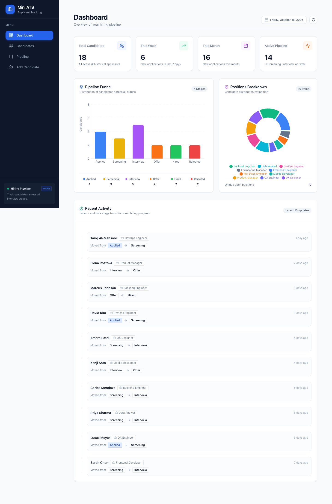
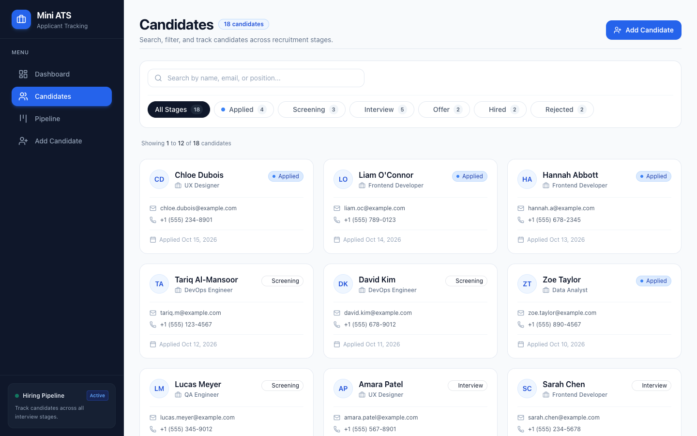
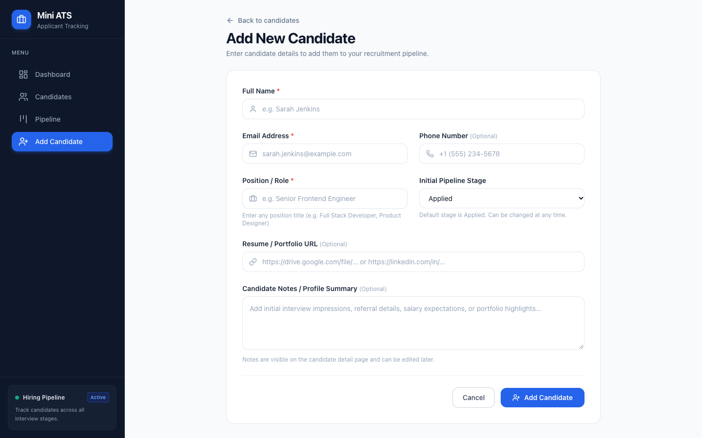
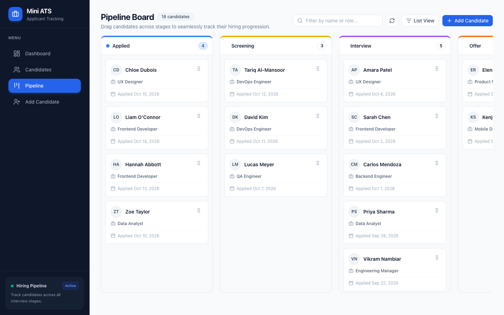
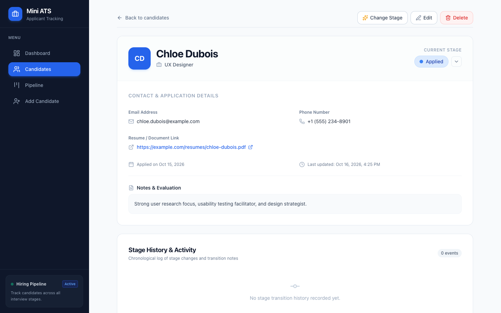

# Mini ATS - Applicant Tracking System

A modern, full-featured Applicant Tracking System built with Next.js 14, designed to streamline your hiring process.


## ✨ Features

### 📊 Dashboard
- Real-time metrics: total candidates, weekly/monthly counts, active pipeline
- Interactive pipeline funnel chart (Recharts)
- Position breakdown pie chart
- Recent activity timeline with stage transitions

### 👤 Candidate Management
- Add, edit, and delete candidates
- Detailed candidate profiles with stage history
- Form validation for required fields
- Stage change with notes tracking

### 📋 Kanban Pipeline Board
- Drag-and-drop candidates between hiring stages
- Visual columns: Applied → Screening → Interview → Offer → Hired / Rejected
- Optimistic UI updates with automatic rollback on error
- Real-time search/filter within the board

### 🔍 Search & Filter
- Global search by name, email, or position
- Filter by hiring stage
- Paginated results
- Sort by name, date, or stage

## 🛠️ Tech Stack

| Layer | Technology |
|-------|-----------|
| **Frontend** | Next.js 14 (App Router), React 18, TypeScript |
| **Styling** | Tailwind CSS 3 |
| **Database** | SQLite via Prisma ORM |
| **Charts** | Recharts |
| **Drag & Drop** | @dnd-kit |
| **Icons** | Lucide React |
| **Date Utils** | date-fns |

## 🚀 Getting Started

### Prerequisites
- Node.js 18+ and npm

### Installation

```bash
# Clone the repository
git clone https://github.com/YOUR_USERNAME/mini-ats.git
cd mini-ats

# Install dependencies
npm install

# Set up the database
cp .env.example .env
npx prisma db push
npx prisma generate

# Seed sample data (optional)
npx tsx prisma/seed.ts

# Start development server
npm run dev
```

Open [http://localhost:3000](http://localhost:3000) to view the app.

## 📁 Project Structure

```
mini_ats/
├── prisma/
│   ├── schema.prisma     # Database schema
│   ├── seed.ts           # Seed data script
│   └── dev.db            # SQLite database
├── src/
│   ├── app/
│   │   ├── api/
│   │   │   ├── candidates/      # CRUD API routes
│   │   │   └── dashboard/       # Dashboard metrics API
│   │   ├── candidates/
│   │   │   ├── [id]/page.tsx    # Candidate detail
│   │   │   ├── new/page.tsx     # Add candidate form
│   │   │   └── page.tsx         # Candidate list
│   │   ├── pipeline/page.tsx    # Kanban board
│   │   ├── layout.tsx           # Root layout with sidebar
│   │   ├── page.tsx             # Dashboard
│   │   └── globals.css
│   ├── components/
│   │   ├── Sidebar.tsx
│   │   ├── SearchBar.tsx
│   │   ├── StageFilter.tsx
│   │   ├── StageBadge.tsx
│   │   ├── CandidateCard.tsx
│   │   ├── DeleteConfirmModal.tsx
│   │   ├── EmptyState.tsx
│   │   └── LoadingSpinner.tsx
│   └── lib/
│       ├── prisma.ts            # Prisma client singleton
│       └── utils.ts             # Utilities & constants
├── .env.example
├── package.json
└── README.md
```

## 🔌 API Endpoints

| Method | Endpoint | Description |
|--------|----------|-------------|
| GET | `/api/candidates` | List candidates (search, filter, sort, paginate) |
| POST | `/api/candidates` | Create new candidate |
| GET | `/api/candidates/:id` | Get candidate details with stage history |
| PUT | `/api/candidates/:id` | Update candidate |
| DELETE | `/api/candidates/:id` | Delete candidate |
| PUT | `/api/candidates/:id/stage` | Update candidate stage |
| GET | `/api/dashboard` | Get dashboard metrics |

## 📸 Screenshots

### Dashboard
The dashboard provides an at-a-glance overview of your hiring pipeline with interactive charts and metrics.



### Candidate List
Browse, search, and filter candidates with a clean card-based layout.



### Add Candidate
Add new candidates with a clean form including validation.



### Kanban Pipeline
Drag and drop candidates across hiring stages in an intuitive board view.



### Candidate Detail
View complete candidate information, edit details, change stages, and review transition history.



## 🚀 Deployment

### Deploy to Vercel

1. Push your code to GitHub
2. Import the repository in [Vercel](https://vercel.com)
3. Deploy — Vercel auto-detects Next.js configuration

> **Note:** For production, consider using PostgreSQL or another production database instead of SQLite.

## 📄 License

This project is open source and available under the [MIT License](LICENSE).

## 🤝 Contributing

Contributions, issues, and feature requests are welcome! Feel free to check the issues page.

---

Built with ❤️ using Next.js, Prisma, and Tailwind CSS
